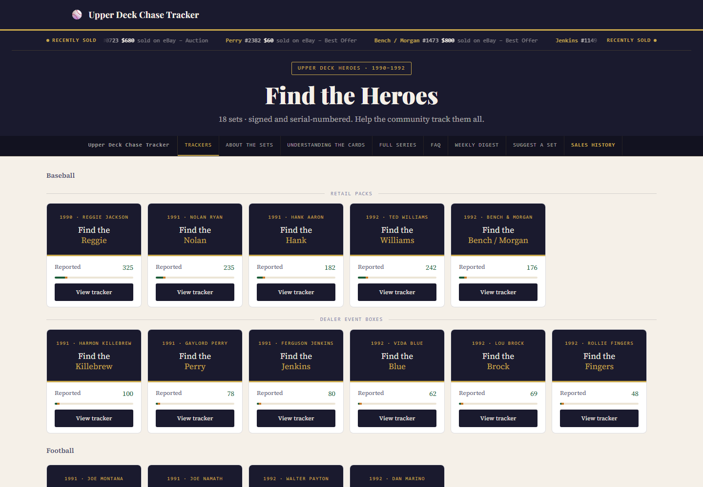
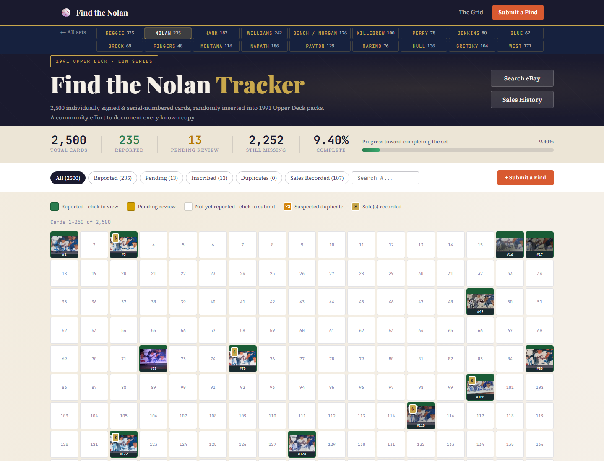
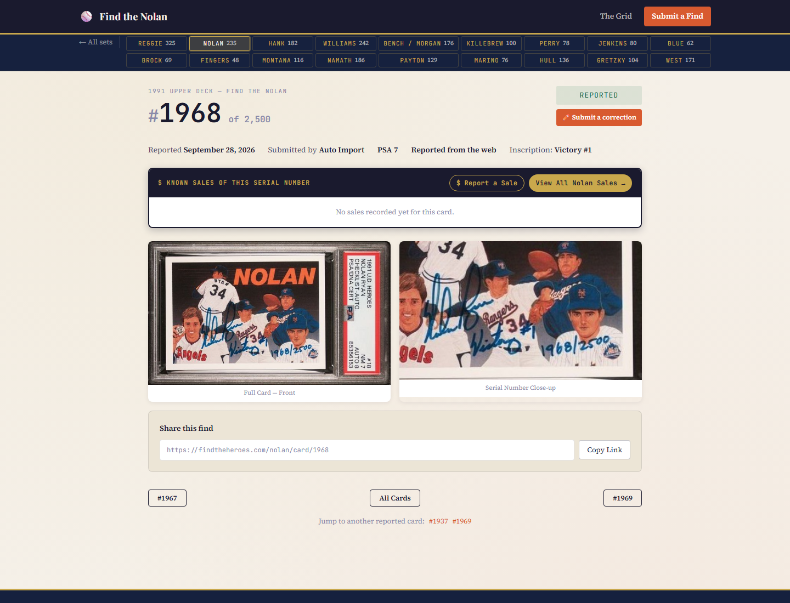
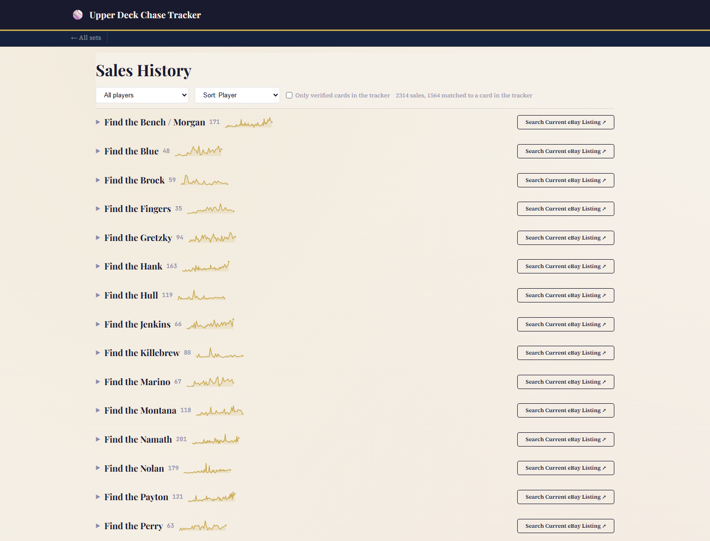
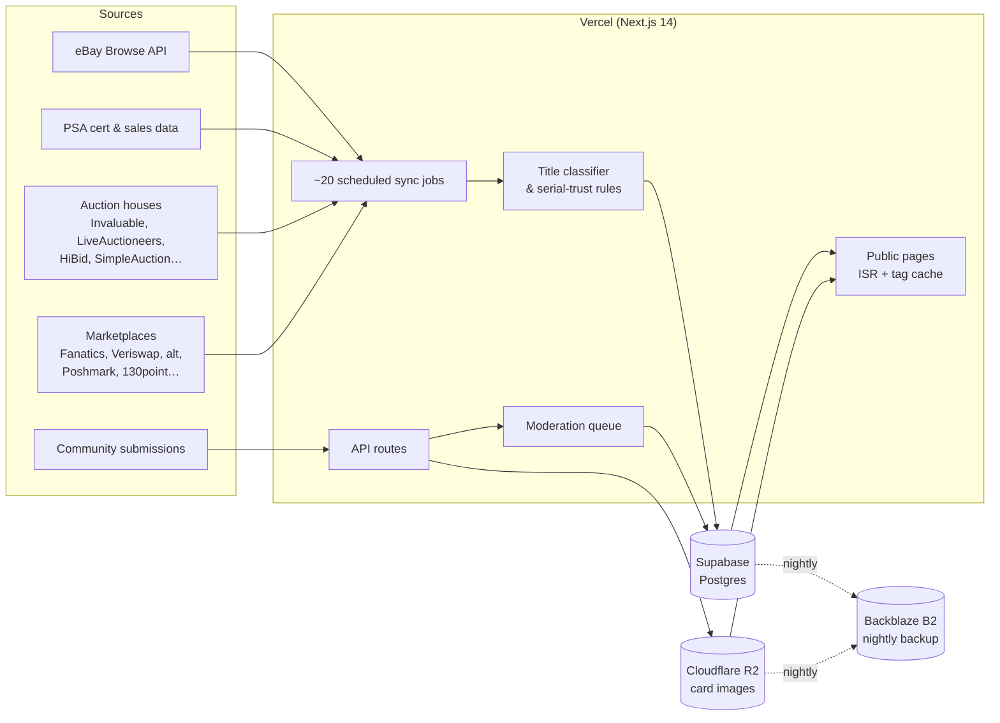

# Find the Heroes

**Live site: [findtheheroes.com](https://findtheheroes.com)**

A community census of Upper Deck Heroes autograph cards (1990–1992). Upper Deck randomly inserted hand-signed, hand-numbered cards of 18 legends — Reggie Jackson, Nolan Ryan, Hank Aaron, Ted Williams, Wayne Gretzky, Joe Montana and others — into packs and dealer boxes. Each set is numbered to 2,500, 2,800 or 3,000, so **48,900 cards** exist in total. Nobody knows where most of them are.

Find the Heroes tracks every copy that has surfaced: which serial numbers have been seen, a photo of each one, who holds it (if they choose to say), and what it has sold for. Thousands are documented so far.

> This repo is a showcase. The application code lives in a private repository; this README describes what it does and how it's built.

---

## Screenshots

**Home — all 18 sets with progress**

**Tracker grid — one tile per serial number; green = reported, gold = pending review**

**Card page — full front, auto-cropped serial close-up, grade, inscription, sales**

**Sales history — every recorded sale, per player, with price sparklines**

---

## What it does

- **Census grid** for each set: every serial number from 1 to the print run, clickable, filterable (reported / pending / inscribed / suspected duplicate / has sales).
- **Card pages** with the full-card photo, a close-up of the signature and handwritten serial, grade and grading company, inscriptions, and the card's own sales history.
- **Community submissions**: anyone can report a find with photos; submissions go into a moderation queue before they appear.
- **Sales history** across eBay, PSA, auction houses and marketplaces, de-duplicated and tied back to the specific serial number when the evidence supports it.
- **Weekly digest email** summarizing newly found cards and new sales.
- **"Recently sold" ticker**, live eBay listing links, SEO-friendly per-card URLs with structured data and a sharded sitemap.

---

## Architecture

| Layer | Choice |
|---|---|
| Framework | Next.js 14 (App Router), React 18, TypeScript |
| Hosting | Vercel — serverless routes + Vercel Cron |
| Database | Supabase (Postgres) |
| Images | Cloudflare R2, processed with `sharp` |
| Backup | Nightly copy to Backblaze B2 |
| Email | Nodemailer digest + IMAP inbox parsing for emailed submissions |
| AI in the app | Claude Haiku vision reads cert numbers off graded-card slab photos |

---

## The AI workflow

The site was built, and is largely operated, by one person working with **[Claude Code](https://claude.com/claude-code)**.

**Building it.** Written in conversation with Claude Code: features, data migrations, scraper adapters for each new source, and the debugging that comes with them. A project instructions file (`CLAUDE.md`) plus topic notes hold the hard-won rules ("a title's /2500 doesn't prove the print run", "verify the deploy the way Vercel builds it"), so every new session starts with what earlier sessions learned.

**Finding cards.** The census grows through agentic "source hunts." Reusable **skills** (packaged instructions Claude follows) cover the recurring jobs:

**Human in the loop.** AI finds and stages; a person approves. Every new card lands as *pending* and needs a human sign-off before it appears as reported, and judgment calls such as possible fakes, conflicting serials or ambiguous photos are flagged for review instead of decided automatically.

**Scheduled automation.** Three layers run unattended: ~20 Vercel cron jobs (marketplace and auction syncs, link health, cache sweep, backup, digest); scheduled Claude tasks in the desktop app (weekly market digest, PSA cert sync); and Windows scheduled tasks for sources that must be fetched from a residential connection.

---

## The sets

| Player | Numbered to | Year |
|---|---|---|
| Reggie Jackson | 2,500 | 1990 |
| Nolan Ryan | 2,500 | 1991 |
| Hank Aaron | 2,500 | 1991 |
| Ted Williams | 2,500 | 1992 |
| Johnny Bench & Joe Morgan | 2,500 | 1992 |
| Harmon Killebrew | 3,000 | 1991 |
| Gaylord Perry | 3,000 | 1991 |
| Fergie Jenkins | 3,000 | 1991 |
| Vida Blue | 3,000 | 1992 |
| Lou Brock | 3,000 | 1992 |
| Rollie Fingers | 3,000 | 1992 |
| Joe Montana | 2,500 | 1991 |
| Joe Namath | 2,500 | 1991 |
| Walter Payton | 2,800 | 1992 |
| Dan Marino | 2,800 | 1992 |
| Brett Hull | 2,500 | 1991 |
| Wayne Gretzky | 2,800 | 1992 |
| Jerry West | 2,500 | 1991 |

---

## Have a card?

Look up its serial number on [findtheheroes.com](https://findtheheroes.com). If it isn't there, use **Submit a Find** on the site.

*Not affiliated with Upper Deck, PSA, eBay or any player. Card images belong to their owners.*
